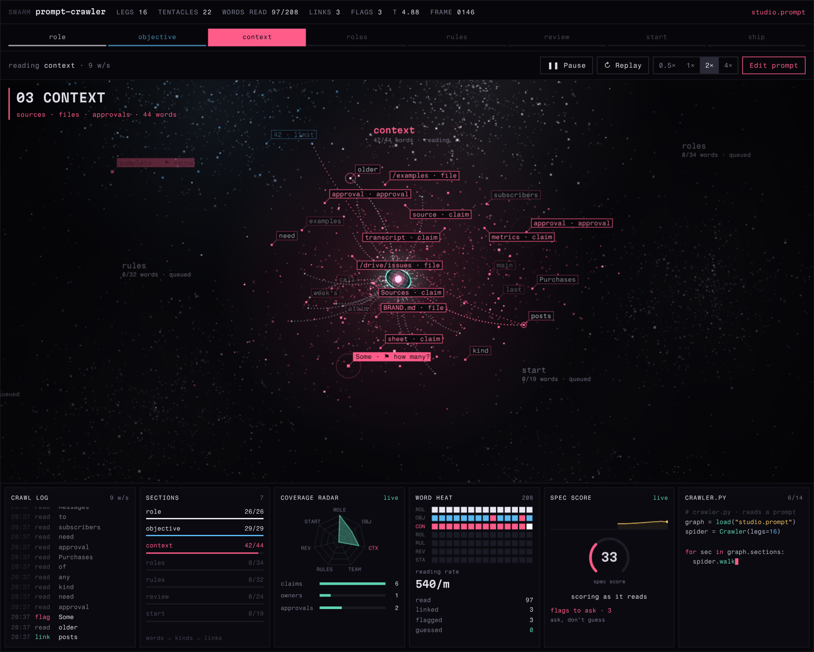
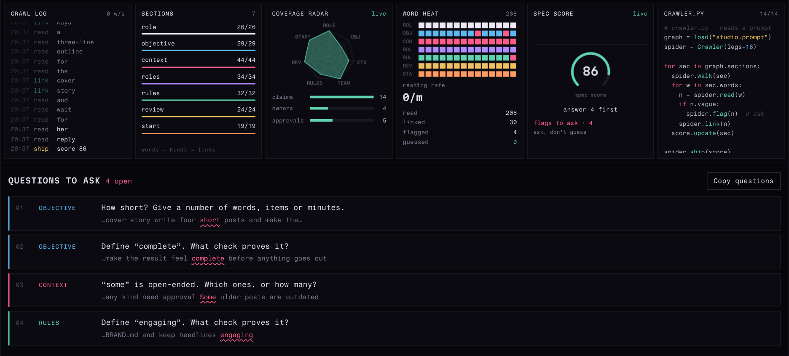

# Prompt Crawler

A spider-like crawler reads a structured AI prompt word by word. Each prompt section is mapped as a particle cloud. The crawler flags vague words, links terms that repeat across sections, and scores how complete the spec is.



## What it does

- Splits a prompt into seven sections: **role, objective, context, roles, rules, review, start**.
- Walks through each section word by word, with a 16-leg crawler reaching out to every word it reads.
- Tags useful terms by kind: claim sources, approvals, owners, files, tools and numeric limits.
- Draws dotted links between terms that appear in more than one section.
- Flags vague words such as "complete", "some", "short" or "soon". Each flag becomes a question to answer before the prompt is run.
- Scores the spec from 0 to 100 as it reads.



## Run it

It's one HTML file. There is no build step and nothing to install.

```bash
git clone https://github.com/kakiizart/prompt-crawler.git
cd prompt-crawler
python3 -m http.server 8000
# then open http://localhost:8000
```

You can also open `index.html` directly in a browser.

## Crawl your own prompt

Click **Edit prompt**, paste a prompt, then press **Crawl this prompt**. Start each section with its name and a colon:

```text
ROLE: You are ...
OBJECTIVE: ...
CONTEXT: ...
ROLES: ...
RULES: ...
REVIEW: ...
START: ...
```

- A missing section becomes a question.
- Text before the first header counts as context.
- These alternate headers also work: `GOAL`, `BACKGROUND`, `TEAM`, `OWNERS`, `CONSTRAINTS`, `CHECKS`, `FIRST STEP`.
- Your draft is saved in your browser's localStorage.

**Controls:** pause or play (Space), replay, speed from 0.5× to 4×. Tap any section tab to jump to it.

## How it works

| Piece | Approach |
|---|---|
| Parsing | A regex finds section headers, then a tokenizer strips punctuation from each word |
| Vague words | A word list grouped by type (quality, quantity, size, time, hedge). Each type has its own question template |
| Term kinds | Pattern rules. Paths and `.md`/`.csv` names are files, "approval" and "sign-off" are approvals, capitalized names under ROLES are owners, and anything with digits is a limit |
| Links | Words are cut down to a short stem. A stem already seen in an earlier section gets a link |
| Score | Each section has a weight: objective and review 20, context and rules 15, the rest 10. The weights add up to 100 |
| Visuals | Canvas 2D: seeded particle clouds for each section, a spring-driven crawler body, legs drawn as dotted Bézier curves, and tags placed with overlap checks |

A section's points are its weight × the share of it already read × its quality, where:

```text
quality = min(1, words / target_words) × max(0.3, 1 − 0.2 × flags)
```

## Limits

- Everything is rule-based. No AI model reads the prompt, so it can miss vague phrasing that isn't on the word list. It can also flag a word that is fine in context.
- It only handles English.
- The score rewards structure and specificity. It does not check whether the instructions are correct.

## Ideas for next steps

- Replace the word rules with typed AI decisions (yes/no, pick-one and 0–5 scores), for example TypeSafe's Jev model. The calls would go through a small server route so the API key never reaches the browser.
- Sort prompts that have no section headers into sections automatically.

## Credits

The visual idea comes from a prompt-crawler demo by defileo on X. This is an independent rebuild, and no code was copied. Built with help from Claude.

Fonts: Martian Mono and Fragment Mono, served by Google Fonts.
